# SeeWow

**Cinema for every screen.** 一个跨平台私人影院播放器：macOS、Windows、Linux、iPadOS、Android 平板共用一套 Flutter 代码与一种视觉语言。本地片库、NAS、WebDAV、Emby / Jellyfin / Plex、DLNA 与 IPTV，最终收进同一个界面。

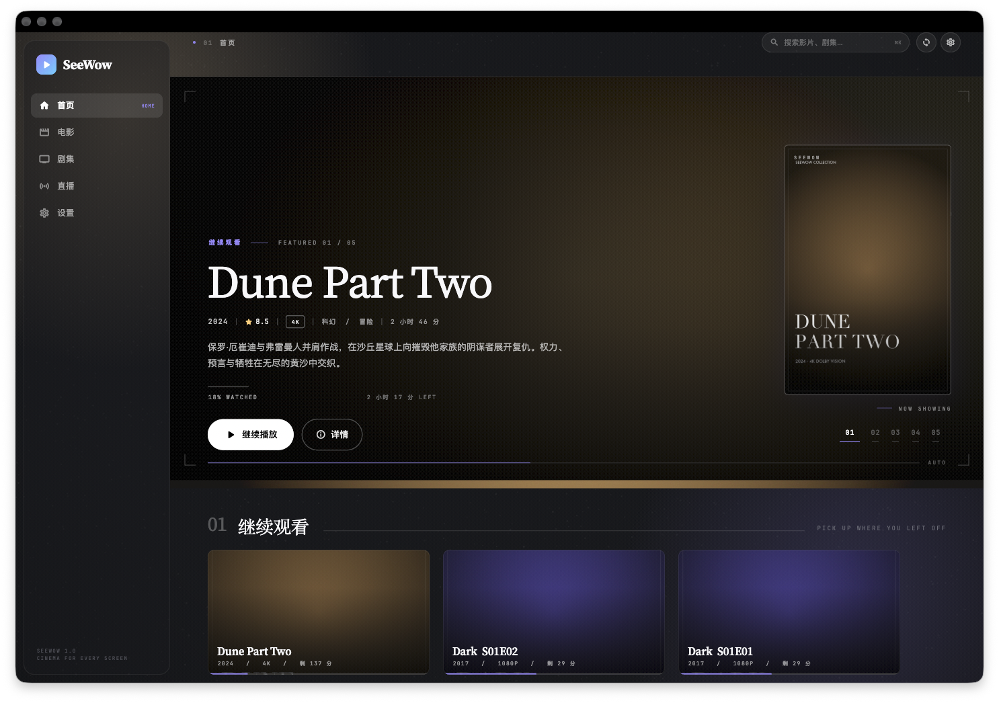

## 安装

**macOS 1.0.0**：[下载 SeeWow-macos-1.0.zip](https://github.com/sevenaaaaaaaaa/SeeWow/releases/latest) → 解压 → 拖进「应用程序」→ 右键「打开」（本地 ad-hoc 签名，未公证；如提示已损坏执行 `xattr -dr com.apple.quarantine /Applications/SeeWow.app`）。需要 macOS 14+（Apple Silicon）。

Windows / Linux / Android 由 CI 产物或本地 `flutter build` 生成，见下文「构建」。

## 一眼看全

| | 能力 |
|---|---|
| **平台** | macOS · Windows · Linux · iPadOS · Android（Flutter 单代码库，响应式三档布局：侧边栏 / 图标栏 / 底部 Tab） |
| **播放** | media_kit + libmpv 内核，软硬解自动协商；播放、暂停、±10s / +30s、音量、全屏、进度回写；直播流自动切换 LIVE 模式（无进度条、不写进度） |
| **片源** | 本地文件夹（系统选择器添加、递归扫描、海报/剧照识别、电影与剧集自动分拣）；**SMB / NAS**（macOS 走 NetFS 系统挂载，Windows 走 `net use`，Linux 走 gio，统一收敛成 file:// 交给 libmpv）；**WebDAV**（PROPFIND 递归扫描 + Basic 鉴权，海报与播放全程带认证头和 Range 请求）；**IPTV**（M3U / M3U8、分组、搜索、XMLTV 节目单、收藏与最近观看）；Emby / Jellyfin / Plex / DLNA 在路线图中 |
| **元数据** | 文件名解析（S01E02 / 1x02 / 第 x 季第 x 集 / 年份 / 4K / HDR / BluRay）、本地 poster / fanart 优先、演示片库内置评分与简介 |
| **整理** | 继续观看、最近添加、电影 / 剧集分栏、搜索、收藏、播放进度持久化 |
| **体验** | Cinema Editorial 视觉语言：中英双语衬线标题、等宽字元数据、编号式版面、海报版画与放映框、颗粒与暗角；620ms 入场编排、9 秒自动放映、指针光与磁吸按钮；三档响应式布局 |

## 截图

| 电影详情 | 播放器 |
|---|---|
| 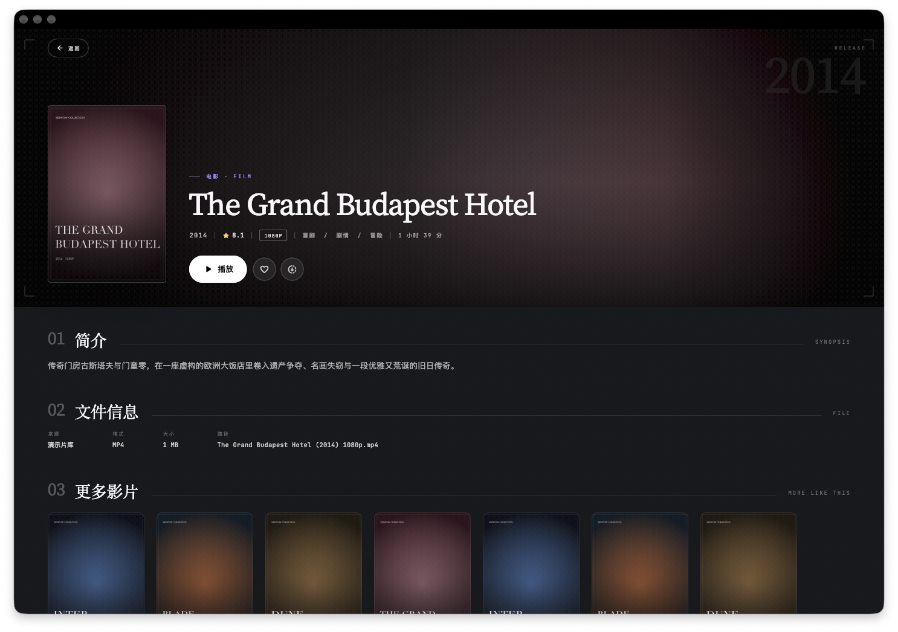 | 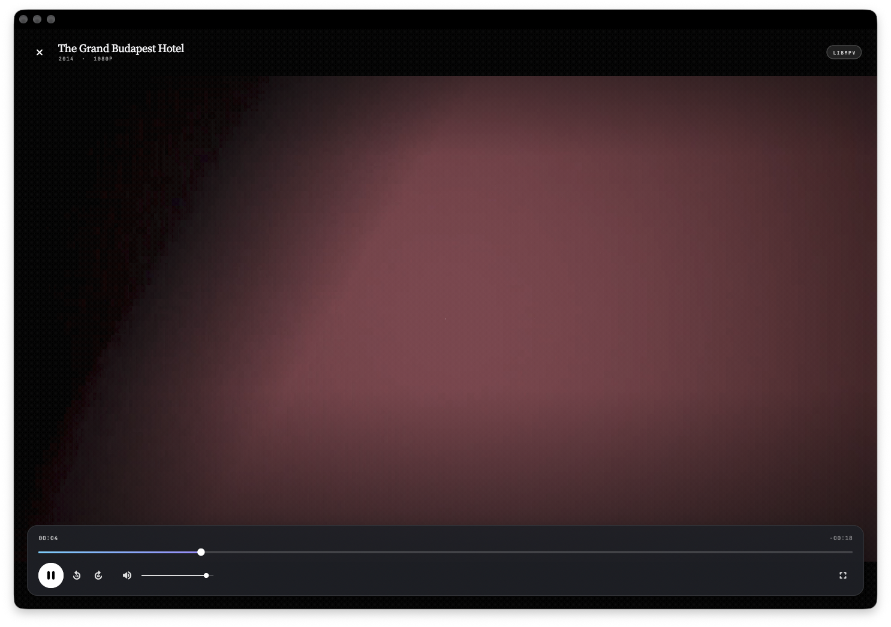 |

| 电影库（编号页头 + 筛选） | 设置（编号卡片） |
|---|---|
| 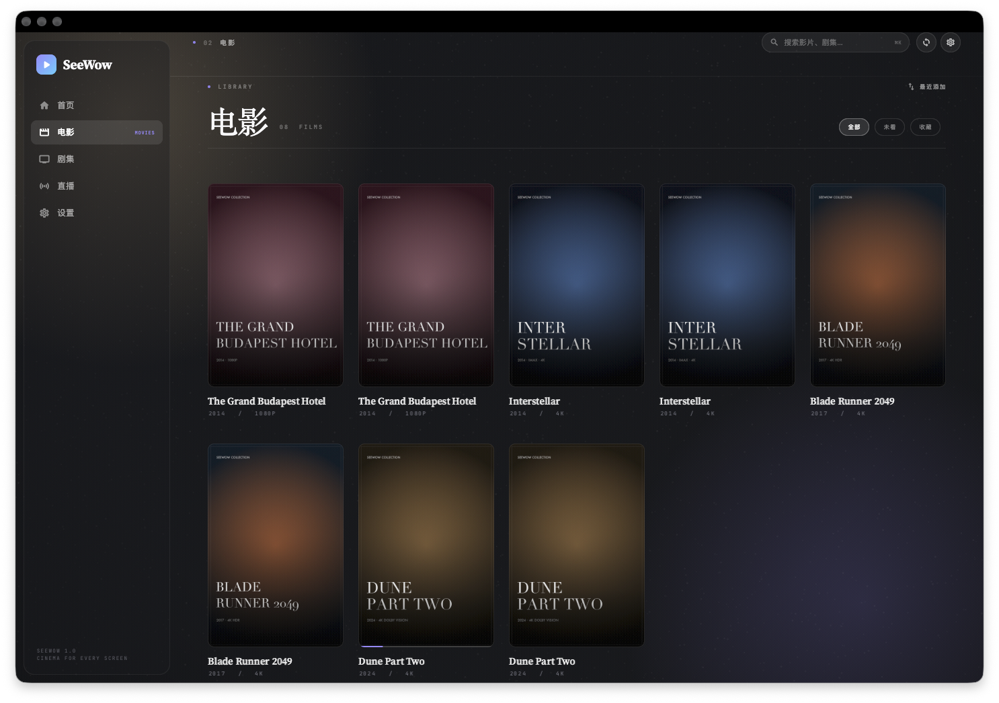 | 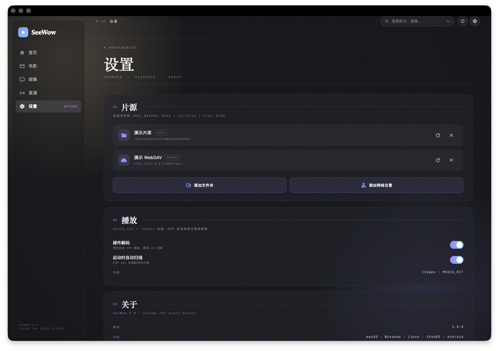 |

| 直播：分组频道 + 正在播 | 直播播放（LIVE 模式） |
|---|---|
| 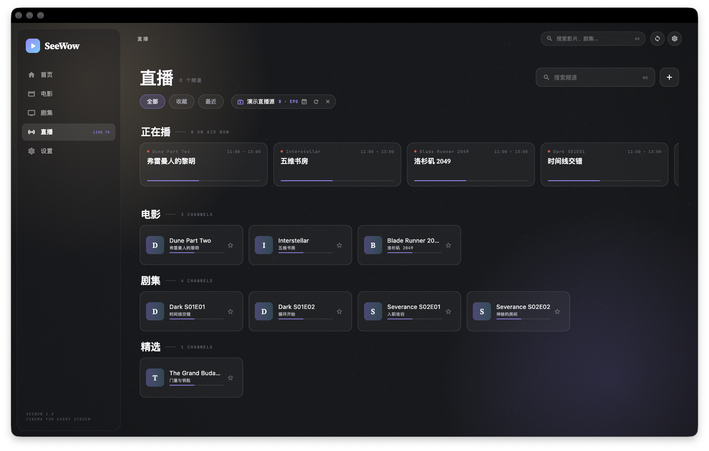 | 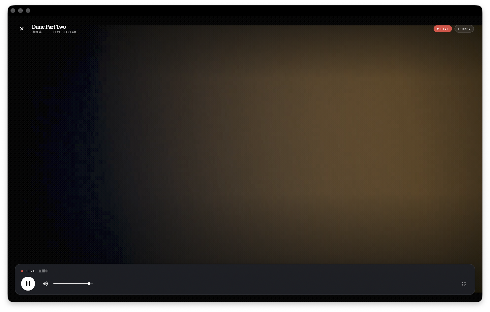 |

| 直播：收藏筛选 | 平板 / 窄窗（图标栏） |
|---|---|
| 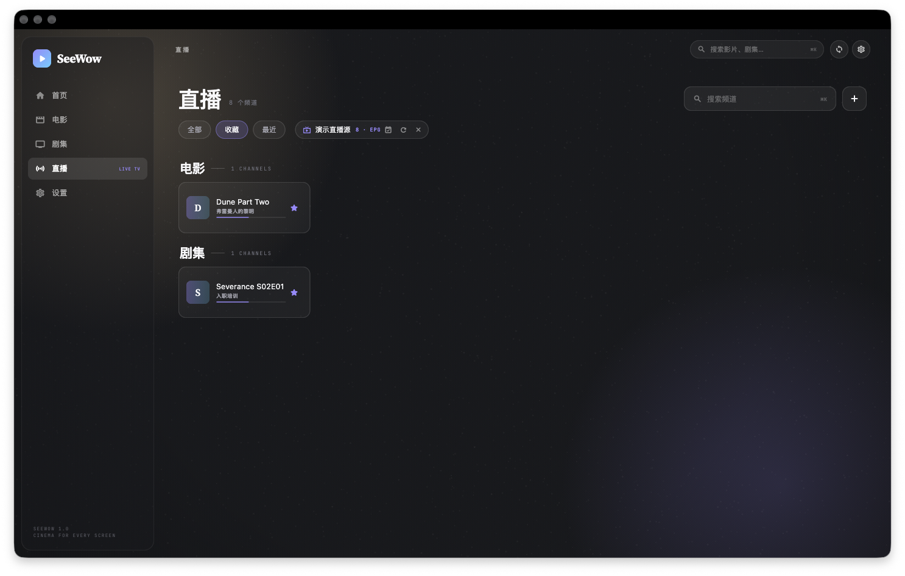 |  |

| 网络片源（SMB / WebDAV） | 添加网络位置 |
| --- | --- |
| 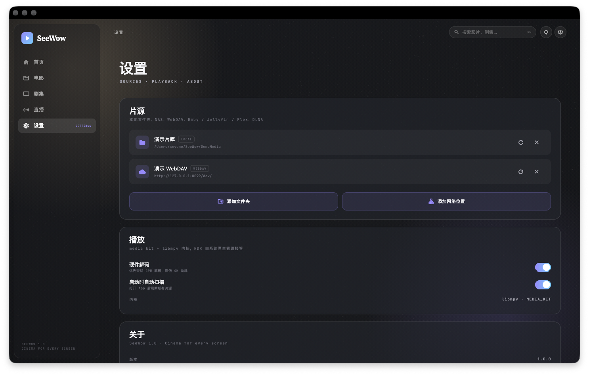 | 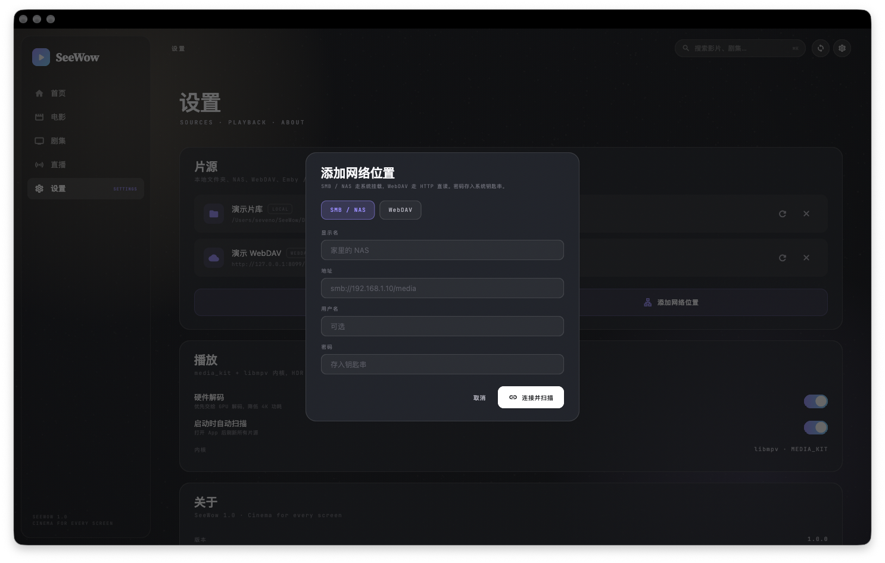 |

| WebDAV 播放（HTTP Range + 认证头） |
| --- |
| 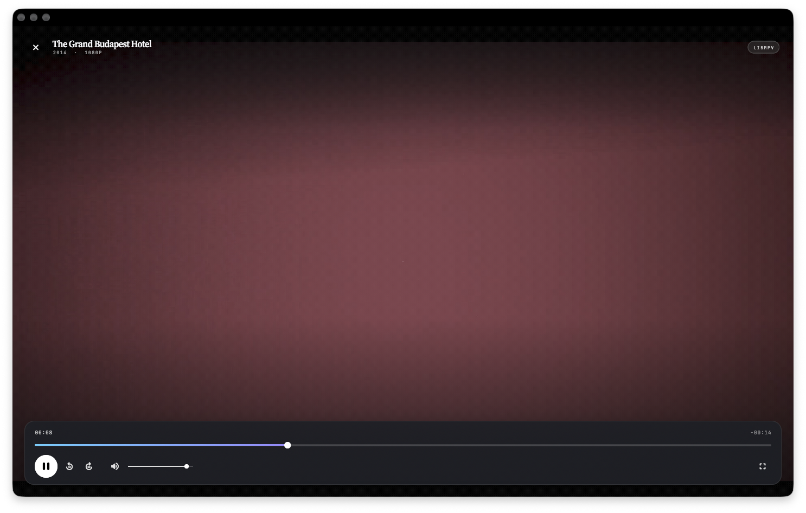 |

## 设计语言：Cinema Editorial

SeeWow 不想做另一个 Infuse 皮肤，它借电影片头与编辑排版的语汇，并要求每个页面都能过「获奖级网页」的八维自检（排版、留白、层级、色彩、动效、微交互、响应式、原创性）：

- **双语衬线**：西文用 Source Serif 4，中文自动落到 Songti SC / Noto Serif CJK，标题在两种语言里都是同一种编辑气质；年份、规格、时间码、页码一律 JetBrains Mono 小字。
- **编号规则**：每个区块由「衬线大号序号 + 标题 + 1px hairline + 大写小字标签」组成（`01 继续观看 ——— PICK UP WHERE YOU LEFT OFF`），把信息层级写成版面。
- **海报版画**：首页 Hero 右侧把当前条目做成带描边与投影的纸上版画，背后压一枚巨大的幽灵序号，下方 `NOW SHOWING`；详情页右上角把发行年份压成浮雕水印。
- **放映框**：Hero、详情头图、空状态四角都有 16px 细括号，像取景器边框。
- **环境光**：全局叠两层低饱和径向光、细颗粒与暗角；Hero 与详情背景从标题散列出色相，再叠 14 秒缓慢推镜。
- **留白节奏**：页面 gutter 随断点 20 / 34 / 56 变化，区块间距 52，标签与正文之间固定 22，避免手写魔法数字。

### 交互

- **入场编排**：每个 Hero 元素按 40 / 90 / 150 / 200 / 240 / 290ms 依次升起（620ms 长尾曲线），页面切换时再整体重放。
- **自动放映**：Hero 每 9 秒轮换，底部一条内嵌 hairline 自行走完并标注 `AUTO`；指针进入即暂停，数字页码可点选。
- **指针光**：海报与横版卡随指针位置做 ±0.08rad 透视倾斜、径向高光、抬升 8px 与描边提亮；同排其它卡自动压暗。
- **磁吸按钮**：主播放键在悬停时向指针方向轻微位移，配合 0.965 按压与 snappy spring；全局按钮共用同一种手感。
- **转场**：旧页沉入环境光、新页自下升起（320ms）；详情页 420ms 淡入 + 3.5% 上移；播放器整层 1.045 → 1.0 推入。
- **三档自适应**：≥1180px 侧边栏；760–1180px 图标栏（iPad 横屏、小窗）；<760px 底部 Tab（手机 / 竖屏平板）。Hero 版画只在 ≥1120px 出现，窄屏让位给标题与按钮。
- **节目单**：直播页顶部「正在播」横向栏，卡片显示当前节目、起止时间与实时进度；频道卡片同样带节目名与进度条。

## 技术架构

```
apps/seewow/
├── lib/
│   ├── app/            # 应用壳、响应式导航、路由、演示片库装载
│   ├── domain/         # MediaItem / MediaSource / 文件名解析 / IPTV 与 XMLTV（纯 Dart，可测试）
│   ├── data/           # LibraryStore / IPTVStore（JSON 持久化）+ LocalScanner（扫描与元数据注入）
│   ├── sources/        # SourceScanner 分派 + WebDavClient/Scanner + SmbMounter + NativeBridge（钥匙串与挂载）
│   ├── playback/       # PlayerScreen（media_kit / libmpv，含 LIVE 模式）
│   ├── features/       # HomeView / DetailView / LiveView / SettingsView
│   └── design/         # tokens、atmosphere、poster_tile、pressable
├── macos/ windows/ linux/ android/ ios/
└── assets/fonts/       # Source Serif 4 + JetBrains Mono
```

- **单代码库**：UI、状态、扫描、播放全部在 `lib/`；平台目录只保留窗口/权限/图标等宿主细节。
- **播放内核**：`media_kit`（libmpv）在各桌面与 Android 统一，iPadOS 的 HDR / 杜比视界后续接原生 AVPlayer 旁路。
- **数据**：`~/Library/Application Support/com.seewow.seewow/SeeWow/library.json`（Windows / Linux 使用对应 application support 目录），无数据库依赖。
- **可测试**：domain 与 sources 层为纯 Dart；`flutter test` 覆盖文件名解析、M3U / XMLTV 解析、WebDAV PROPFIND 与 401、Basic 认证头、SMB 地址解析（11 项）。
- **凭证**：用户名写在片源记录里，密码只进系统钥匙串（macOS Keychain，非 macOS 退化为 secrets.json 并 chmod 600），不上传、不写日志。

## 网络片源

两类源共用同一条播放管线：扫描只负责把条目变成 MediaItem，播放器只认 locator + httpHeaders。

- **SMB / NAS**：SmbMounter 先看缓存，再用系统客户端挂载到 Application Support/SeeWow/mounts/<sourceId>（macOS NetFSMountURLSync，Windows net use，Linux gio mount），随后交给本地扫描器；SMB 播放因此走本地 file://，不依赖 libsmbclient。认证错误码 -5995 / -5996 / -5997 / -6003 / -6004 会转成「用户名或密码不正确」。
- **WebDAV**：WebDavClient 发 PROPFIND Depth: 1，兼容 D: / d: / 无前缀命名空间；WebDavScanner 递归建库，识别 poster.jpg / folder.jpg / fanart.jpg，海报与视频都用同一套认证头。
- 桌面端挂载完成后断网只会影响新请求；移动端 SMB 仍需 libsmb2 + 本地 HTTP Range 桥，尚未实现。

本地自测（不需要 NAS）：仓库带一个只用标准库实现的 WebDAV 服务器，把 DemoMedia/ 暴露在 http://127.0.0.1:8099/dav/（账号 swd / swd，支持 PROPFIND 与 Range）：

```bash
python3 Tools/webdav_demo_server.py DemoMedia 8099 &
SEEWOW_ADD_WEBDAV='演示 WebDAV|http://127.0.0.1:8099/dav/|swd|swd' SEEWOW_RESCAN=1 SEEWOW_LAUNCH=home ./apps/seewow/build/macos/Build/Products/Debug/seewow.app/Contents/MacOS/seewow
```

SEEWOW_SMB_PROBE=1 会在启动时验证钥匙串读写与原生挂载通道（用不可达主机，预期得到挂载失败而不是 MissingPluginException）。

## 构建

前置：Flutter 3.47+、各平台原生工具链。桌面播放需要 libmpv（macOS：`brew install mpv`；Linux：`libmpv-dev`；Windows：media_kit 自带运行时）。

```bash
cd apps/seewow
flutter pub get
flutter run -d macos          # 或 windows / linux / chrome
flutter build macos --release
flutter build windows --release
flutter build linux --release
flutter build apk --release
flutter build ios --release --no-codesign
```

CI：[.github/workflows/flutter.yml](.github/workflows/flutter.yml) 在 GitHub Actions 上构建 macOS / Windows / Linux / Android / iOS 五端产物。

### 演示模式

仓库带一个 10 条目的演示片库（`DemoMedia/`，9.7 MB，由 `Tools/make_demo_media.sh` 生成）。App 启动时会向上查找 `DemoMedia`，找到即自动接入；也可用环境变量指定：

```bash
SEEWOW_DEMO_PATH=/path/to/DemoMedia \
SEEWOW_WINDOW=1440x900 \
SEEWOW_LAUNCH=home|movies|tv|live|liveplay|settings|detail|play \
SEEWOW_IPTV_DEMO=/path/to/DemoMedia/live-demo.m3u \
SEEWOW_IPTV_EPG=/path/to/DemoMedia/live-demo.xml \
SEEWOW_LIVE_FILTER=favorites|recent \
SEEWOW_ADD_WEBDAV='演示 WebDAV|http://127.0.0.1:8099/dav/|swd|swd' \
SEEWOW_RESCAN=1 \
SEEWOW_SMB_PROBE=1 \
  ./apps/seewow/build/macos/Build/Products/Debug/seewow.app/Contents/MacOS/seewow
```

`DemoMedia/live-demo.m3u` 是一个指向演示视频的假直播列表，`live-demo.xml` 是对应的 XMLTV 节目单（8 频道 × 4 段），两者合起来可以在无真实直播源时验证分组、搜索、「正在播」与 LIVE 播放链路。节目单时间会过期，重新生成即可：`python3 Tools/make_demo_epg.py`。

## 路线图

- **片源**：移动端 SMB（libsmb2 + 本地 HTTP Range 桥）、Emby / Jellyfin / Plex、DLNA；IPTV 回看 / 时移与完整节目单页；跨源同名片目合并。
- **播放**：字幕（外挂 SRT/VTT + 音轨切换）、帧预览与滚轮 seek、PiP、iPadOS 原生 AVPlayer 旁路（HDR / 杜比视界）。
- **元数据**：TMDB 中文元数据与在线海报、剧集季/集海报。
- **体验**：⌘K 全局跳转、Hero 静音动态预览、播放器手势层。

## 已知限制

- 片源已接入本地文件夹、SMB / NAS（桌面）、WebDAV、IPTV。
- SMB 只在桌面生效，移动端尚未接 libsmb2；同一部片子同时来自本地与网络源时会各显示一份（跨源去重在路线图）。
- WebDAV 目前只做读取（PROPFIND + GET/HEAD + Range），不支持写回、加锁与 Digest 认证；Windows / Linux 的 SMB 分支尚未真机验证。
- 直播已支持 M3U 分组、XMLTV 节目单、收藏与最近观看；暂无回看 / 时移，节目单只解析 XMLTV（不支持 TVG 订阅源里的 gzip 归档）。
- libmpv 使用软件/纹理渲染路径，4K 高码率在低端设备上 CPU 占用偏高；HDR 需原生旁路。
- macOS 开发构建关闭了 App Sandbox 以便读取任意演示目录；上架版本需改回沙箱 + security-scoped bookmark。
- macOS release 已本机实测（首页 / 详情 / 播放 / 设置、1440×900 与 1024×768）；Android APK 在本机构建受 Gradle 守护进程锁阻塞，改由 CI 五端流水线产出，尚未在本机安装验证。

## 旧版

仓库根目录的 `Sources/` 是 SeeWow 的 macOS 原生 SwiftUI 原型（AVPlayer + libmpv 双内核、SMB/WebDAV/Emby/Plex/DLNA/IPTV 全套适配器），作为跨平台重构的能力参照保留，见 `Package.swift` 与 `build_app.sh`。